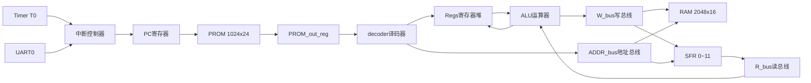

# HMC8处理器

>一套从指令集、汇编器到RTL全部自研的16位模型机，已在安路EG4与Altera Cyclone IV E两个平台上综合布线，并用定时器中断驱动LED的汇编程序完成板级验证。

## 一、简介

HMC8是一台自己定义指令集、自己实现硬件的16位处理器。它不基于任何现成软核，指令集、编码格式、微架构、汇编器与工具链均为独立设计。

设计目标是一台"能写程序、能上板、能在两个不同厂商的FPGA上跑起来"的完整小机器，因此取舍上明显偏向**小面积+结构清晰**：乘除法用串行移位迭代实现（不占DSP块），程序与数据分开存放在PROM与RAM中，外设（定时器、UART）统一挂在特殊功能寄存器（SFR）上，中断走一个共用向量加软件查询的结构。

目前状态：RTL、汇编器、两个平台的工程与仿真流程均已打通，`asm/`下两个定时器中断例程（闪灯、流水灯）已通过板级验证。

## 二、主要特性

| 项目 | 内容 |
| --- | --- |
| 指令集 | 33条定长指令，24位指令字 |
| 通用寄存器 | 16个，每个16位（`R0`~`R15`） |
| 程序存储器 | PROM 1024×24（片内BRAM） |
| 数据存储器 | RAM 2048×16（片内BRAM） |
| 特殊寄存器 | 12个16位SFR（地址0~11），集中管理外设与中断 |
| 中断源 | 5路：软件中断S0/S1、定时器T0、UART0接收、UART0发送 |
| 定时器 | T0，带2位分频，阈值可编程，溢出可产生中断 |
| 串口 | UART0，9600波特率，收发各带中断标志 |
| 乘法 | 串行移位加法，约9拍完成，无符号 |
| 除法 | 串行恢复余数法，每拍2位，约9拍完成，无符号 |
| 可移植性 | 同一套RTL，用`ip_sel`参数切换Altera/安路两种IP例化方式 |
| 目标器件 | Altera EP4CE6E22C8；安路EG4S20BG256 |
| 工具链 | Quartus Prime 17.1、安路TD 5.6、ModelSim |
| 配套软件 | 自研Python汇编器（tkinter图形界面，含自研GUI框架） |
| 验证状态 | 定时器中断驱动LED的两个例程已通过板级验证 |

## 三、目录结构

```
HMC8/
├─ altera/                     #Altera（Cyclone IV E）工程
│  ├─ HMC8.qpf / HMC8.qsf      #Quartus工程与设置
│  ├─ HMC8.out.sdc             #时序约束（50MHz）
│  ├─ PROM.mif                 #程序存储器初始化文件（汇编器输出）
│  ├─ ip/                      #altsyncram生成的PROM/RAM
│  ├─ sim/                     #测试台与仿真脚本
│  └─ src/                     #设计源码（与安路工程共用同一份）
│
├─ al/HMC8/                    #安路（EG4）工程
│  ├─ HMC8.al                  #TD工程文件
│  ├─ HMC8.sdc                 #时钟约束
│  ├─ IO_pin.adc               #引脚分配
│  ├─ al_PROM.mif              #程序存储器初始化文件（汇编器输出）
│  ├─ ip/                      #安路IP生成的PROM/RAM（例化EG_LOGIC_BRAM）
│  ├─ asm/                     #板级验证用的汇编源码（闪灯、流水灯）
│  ├─ sim/                     #测试台与RTL仿真脚本
│  └─ HMC8_Runs/               #TD生成的综合/布局布线结果与仿真网表
│
├─ asm/                        #汇编器与汇编源码
│  ├─ 汇编程序.txt              #指令集各功能测试程序（含注释掉的用例）
│  └─ HMC8汇编器/
│     ├─ HMC4.1汇编器.py        #汇编器主程序（GUI）
│     ├─ ISA.py                #指令表：助记符、操作码、正则
│     └─ my_tkui.py            #自研tkinter控件库
│
└─ doc/riscv/                  #ISA设计时整理的RISC-V参考资料
```

设计源码统一放在`altera/src/`，两个平台共用；安路工程通过相对路径引用同一份文件，避免了两份RTL分叉。

## 四、系统架构

### 4.1模块划分

| 文件 | 行数 | 功能 | 关键点 |
| --- | --- | --- | --- |
| `HMC8_SOC.v` | 183 | 顶层：RAM、SFR、中断控制器、定时器、UART实例化 | 用`ip_sel`参数切换两家IP |
| `HMC8.v` | 108 | 处理器核心：PC、取指、寄存器堆与ALU互连 | 含PROM例化与PC选择逻辑 |
| `decoder.v` | 142 | 译码器：生成全部控制信号 | 所有输出为寄存输出，与流水相位对齐 |
| `ALU.v` | 54 | 运算器：算术、逻辑、移位、比较、乘除调度 | 乘除结果优先于操作码译码 |
| `Regs.v` | 48 | 16×16位寄存器堆 | 双写口，支持半字写（`LB`） |
| `MUL_serial.v` | 76 | 串行乘法器 | 每拍2位，8拍出结果 |
| `DIV_serial.v` | 74 | 串行除法器 | 恢复余数法，每拍2位 |
| `pip_control.v` | 28 | 流水线停滞控制 | 乘除期间拉低`en`冻结流水线 |
| `jmp_control.v` | 20 | 跳转目标与返回地址计算 | 同时输出`PC_CH`供中断捕获 |
| `Timer.v` | 38 | T0定时器 | 分频、计数、溢出脉冲 |
| `UART_send.v` | 86 | 串口发送 | 9600波特率，按50MHz时钟分频 |
| `UART_receive.v` | 90 | 串口接收 | 9600波特率，起始位检测与移位采样 |

### 4.2数据通路



指令执行采用"取指—译码—执行写回"三个错相位节拍：`PC`指向当前取指地址，`PROM_out_reg`保存上一条取回的指令，译码器的寄存输出再滞后一节拍驱动寄存器堆与ALU。乘除法属于多周期单元，执行期间`pip_control`拉低`en`冻结PC与译码器，等`finish`到达后写回结果。

### 4.3地址空间

| 范围 | 归属 | 说明 |
| --- | --- | --- |
| 0~1023 | PROM | 程序存储器，24位宽，由`PC_mux`驱动 |
| 0~2047 | RAM | 数据存储器，`L=1`且`SFR_wr=0`时写入 |
| 0~11 | SFR | 特殊功能寄存器，由`LSR`/`ESR`访问 |
| ≥2048 | IO | 保留给外部I/O，目前设计里仅占位 |

读总线`R_bus`的选择规则：`SFR_wr=1`时读SFR；否则地址小于2048读RAM；再否则读`IO`。

## 五、中断系统

### 5.1中断源与寄存器

中断标志与使能共用一个5位布局，标志在`SFR[2]`，使能在`SFR[3]`：

| 位 | 中断源 | 置位条件 |
| --- | --- | --- |
| 4 | S1软件中断 | 软件写`SFR[2][4]` |
| 3 | S0软件中断 | 软件写`SFR[2][3]` |
| 2 | T0定时器溢出 | `TI0`脉冲且`SFR[3][2]=1` |
| 1 | UART0接收完成 | `RI`且`SFR[3][1]=1` |
| 0 | UART0发送完成 | `TI`且`SFR[3][0]=1` |

中断相关寄存器：

| SFR | 用途 | 关键位 |
| --- | --- | --- |
| `SFR[2]` | 中断标志 | 见上表；写0可清标志 |
| `SFR[3]` | 中断使能 | 见上表，逐位使能 |
| `SFR[4]` | 中断控制 | bit1=总中断允许（`IF`）；bit0=清边沿检测（写1，硬件自动只保持一拍） |
| `SFR[5]` | 中断服务程序入口地址 | 16位向量 |
| `SFR[8]` | 中断返回地址 | 中断被接受那一拍自动捕获，只读 |

### 5.2中断响应流程

1. 某个标志置位且对应使能位为1，`I=|SFR[2]`上升沿被检测到；
2. 若总中断允许（`SFR[4][1]=1`），下一拍`PC`跳到`SFR[5]`，同时把"本来该执行的下一条指令地址"写进`SFR[8]`；
3. 服务程序开头用`ESR 8 Rx`取回返回地址，保存到通用寄存器；
4. 处理完先清中断源（写`SFR[2]`对应位为0），再写`SFR[4]=3`清除边沿检测并保持总中断允许；
5. `JALR Rx`返回断点。

第4步的顺序很关键：**必须先清中断源，再清边沿检测**。如果先清了边沿检测而源标志还在，会立刻再触发一次中断。

### 5.3参考实现

`al/HMC8/asm/闪灯.txt`是标准写法，可以当模板：

```asm
；初始化部分
LB LOW 100 R6
LB LOW @INT R0      ；中断服务程序入口地址
LSR 5 R0            ；写入SFR[5]
LB LOW 60000 R0
LB HIGH 60000 R0    ；T0阈值=60000
LSR 7 R0            ；写入SFR[7]
LB LOW 2 R0
LSR 6 R0            ；开启T0（SFR[6][1]=1）
LB LOW 4 R0
LSR 3 R0            ；使能T0中断（SFR[3][2]=1）
LB LOW 2 R0
LSR 4 R0            ；开总中断（SFR[4][1]=1）
@LOOP
JAL @LOOP R1        ；死循环等中断

；中断服务程序
@INT
ESR 8 R2            ；取出返回地址
ADDI 1 R5 R5        ；计数
BGEU R6 R5 R7       ；计满100
JAL @JMP R7
ANDI 0 R5 R5
ADDI 1 R3 R3
LSR 0 R3            ；输出到out端口（LED）
@JMP
ANDI 0 R9 R9
LSR 2 R9            ；清T0中断标志
ADDI 3 R9 R9
LSR 4 R9            ；清边沿检测，保持中断允许
JALR R2             ；返回断点
```

## 六、定时器T0

| 寄存器 | 位 | 含义 |
| --- | --- | --- |
| `SFR[6]` | 0 | 计数器清零（电平有效，写1期间计数保持0） |
| `SFR[6]` | 1 | 定时器使能 |
| `SFR[6]` | 3:2 | 分频系数，实际分频为`{SFR[6][3:2]}+1` |
| `SFR[6]` | 4 | 溢出标志，由硬件置1，写0清除 |
| `SFR[7]` | 15:0 | 计数阈值`val` |

中断周期为`(val+1)×(分频系数)`个时钟。以50MHz、`val=60000`、不分频为例，中断周期约1.2ms，闪灯例程每100次中断翻转一次，约120ms更新一次LED。

注意`val=0`时计数器停在0，溢出标志只在第一次置位，不会周期性产生中断。

## 七、UART0

| 寄存器 | 位 | 含义 |
| --- | --- | --- |
| `SFR[9]` | 0 | 发送使能，写1启动一次发送 |
| `SFR[9]` | 1 | 接收使能 |
| `SFR[9]` | 2 | 发送忙标志（只读） |
| `SFR[10]` | 7:0 | 发送数据 |
| `SFR[11]` | 7:0 | 接收数据 |

波特率由`UART_send.v`/`UART_receive.v`顶部的`parameter Baud=9600`与`parameter sys_clk=50_000_000`决定。**这两个参数必须与实际输入时钟一致**：如果板上晶振不是50MHz，需要同步修改，否则收发波特率会成比例偏差。

发送流程：写`SFR[10]`装数据，再写`SFR[9][0]=1`启动；发送完成产生`TI`脉冲，可触发中断。
接收流程：写`SFR[9][1]=1`使能接收；收到完整字节产生`RI`脉冲，数据在`SFR[11]`。

## 八、指令集

### 8.1指令表

立即数型指令的`imm`为10位：`ADDI`/`SLTI`/`XORI`/`ORI`/`ANDI`做符号扩展，`SLLI`/`SRLI`/`SRAI`做零扩展。

| 助记符 | 操作码 | 格式 | 汇编语法 | 语义 |
| --- | --- | --- | --- | --- |
| `NOP` | 0 | nop | `NOP` | 空操作 |
| `ADDI` | 1 | imm | `ADDI imm R2 R3` | `R3=R2+sext(imm)` |
| `SLTI` | 2 | imm | `SLTI imm R2 R3` | `R3=(R2<sext(imm))?1:0`（有符号） |
| `SLLI` | 3 | imm | `SLLI imm R2 R3` | `R3=R2<<imm` |
| `SRLI` | 4 | imm | `SRLI imm R2 R3` | `R3=R2>>imm` |
| `ADD` | 5 | r | `ADD R1 R2 R3` | `R3=R1+R2` |
| `SUB` | 6 | r | `SUB R1 R2 R3` | `R3=R1-R2` |
| `SLL` | 7 | r | `SLL R1 R2 R3` | `R3=R1<<R2` |
| `SRL` | 8 | r | `SRL R1 R2 R3` | `R3=R1>>R2` |
| `AND` | 11 | r | `AND R1 R2 R3` | `R3=R1&R2` |
| `OR` | 12 | r | `OR R1 R2 R3` | `R3=R1\|R2` |
| `XOR` | 13 | r | `XOR R1 R2 R3` | `R3=R1^R2` |
| `JAL` | 14 | jal | `JAL @标签R3` | `R3[0]=1`时`PC=PC+off`，否则`PC=PC+1` |
| `JALR` | 15 | jalr | `JALR R1` | 无条件跳转到`R1`，返回地址存`SFR[1]` |
| `BEQ` | 16 | r | `BEQ R1 R2 R3` | `R3=(R1==R2)?1:0` |
| `BNE` | 17 | r | `BNE R1 R2 R3` | `R3=(R1!=R2)?1:0` |
| `BLT` | 18 | r | `BLT R1 R2 R3` | `R3=(R1<R2)?1:0`（有符号） |
| `BGE` | 19 | r | `BGE R1 R2 R3` | `R3=(R1>=R2)?1:0`（有符号） |
| `BLTU` | 20 | r | `BLTU R1 R2 R3` | `R3=(R1<R2)?1:0`（无符号） |
| `BGEU` | 21 | r | `BGEU R1 R2 R3` | `R3=(R1>=R2)?1:0`（无符号） |
| `LB` | 22 | lb | `LB LOW\|HIGH数值R3` | 取低8位或高8位装入寄存器 |
| `LSR` | 23 | lsr | `LSR imm R2` | `SFR[imm]=R2` |
| `ESR` | 24 | esr | `ESR imm R2` | `R2=SFR[imm]` |
| `IN` | 25 | in | `IN R1 R2` | `R2=RAM[R1]` |
| `OUT` | 26 | out | `OUT R1 R2` | `RAM[R1]=R2` |
| `MUL` | 27 | md | `MUL R1 R2 R3 R4` | `{R1,R4}=R2*R3`（无符号） |
| `DIV` | 28 | md | `DIV R1 R2 R3 R4` | `R1=R2%R3`，`R4=R2/R3`（无符号） |
| `XORI` | 29 | imm | `XORI imm R2 R3` | `R3=R2^sext(imm)` |
| `ORI` | 30 | imm | `ORI imm R2 R3` | `R3=R2\|sext(imm)` |
| `ANDI` | 31 | imm | `ANDI imm R2 R3` | `R3=R2&sext(imm)` |
| `SRAI` | 32 | imm | `SRAI imm R2 R3` | `R3=R2>>>imm` |
| `SRA` | 33 | r | `SRA R1 R2 R3` | `R3=R1>>>R2`（算术右移） |
| `SLA` | 34 | r | `SLA R1 R2 R3` | `R3=R1<<<R2`（算术左移，位级与`SLL`等价） |

### 8.2编码格式

指令字24位，高6位为操作码，其余字段按格式划分：

| 格式 | 字段（高位:低位） |
| --- | --- |
| imm | op[23:18] imm[17:8] a[7:4] c[3:0] |
| r | op[23:18] b[11:8] a[7:4] c[3:0] |
| nop | op[23:18] |
| lb | op[23:18] byte[17:8] hi[4] r[3:0] |
| lsr | op[23:18] idx[17:8] a[7:4] |
| esr | op[23:18] idx[17:8] c[3:0] |
| in | op[23:18] b[11:8] c[3:0] |
| out | op[23:18] b[11:8] a[7:4] |
| md | op[23:18] d[15:12] b[11:8] a[7:4] c[3:0] |
| jal | op[23:18] off[17:4] cond[3:0] |
| jalr | op[23:18] f[7:4] |

其中`a`/`b`是源寄存器，`c`/`d`是目的寄存器（`LB`半字写与乘除双写口会同时用到两个目的寄存器）。

### 8.3指令级注意事项

| 事项 | 说明 |
| --- | --- |
| 乘除后必须跟`NOP` | 详见第十节；汇编时把`NOP`放在`MUL`/`DIV`的下一条 |
| `MUL`/`DIV`为无符号 | 有符号运算需软件自行处理符号 |
| 除零未定义 | 除数为0时结果无意义，程序需自行判断 |
| `JAL`条件寄存器需提前设置 | 条件寄存器至少提前2条指令写好，不能紧邻 |
| 移位量超过15按硬件语义处理 | `<<`/`>>`在移位量≥16时为0，`>>>`为全符号位 |
| `LB`的`LOW`/`HIGH` | 两次写同一寄存器，先`LOW`后`HIGH` |

## 九、汇编器

### 9.1位置与启动

```
asm/HMC8汇编器/HMC4.1汇编器.py
```

用Python 3运行（仓库内自带`.venv`）。界面左侧选择源文件、`保存`、`编译并保存`三个按钮，右侧上方是带语法高亮的编辑区，下方是日志区。

### 9.2汇编语法

| 语法 | 说明 |
| --- | --- |
| `;`或`；` | 行注释，行内注释同样支持 |
| `@标签` | 跳转地址标签，单独占一行 |
| `R0`~`R15` | 通用寄存器 |
| `10`、`-37`、`300U` | 立即数，支持有符号与`U`后缀 |
| `658` | 立即数格式支持十进制 |
| `LOW`/`HIGH` | `LB`指令的字节选择 |

### 9.3输出

汇编结果是Quartus/安路都能读的MIF文件，头部固定为`WIDTH=24`、`DEPTH=1024`。把生成的MIF覆盖到工程对应位置即可：

| 平台 | 目标文件 |
| --- | --- |
| Altera | `altera/PROM.mif` |
| 安路 | `al/HMC8/al_PROM.mif` |

### 9.4已知待修

汇编器界面里的指令说明文本（`order_show`）还有两处与RTL不一致，以本README第八节为准：

- `ANDI`一行写成了`R3=R2|sext(imm)`，应为`&`；
- `SRA`一行操作数顺序写反，且末尾多一个分号；另有一行残留的`SRL ... R3=R2<<<R1`实际描述的是`SLA`。

## 十、上手指南

### 10.1安路EG4（板级验证平台）

1. 用TD打开`al/HMC8/HMC8.al`；
2. 用汇编器编译源程序，把生成的MIF另存为`al/HMC8/al_PROM.mif`；
3. 运行综合与布局布线，生成bitstream；
4. 引脚分配在`al/HMC8/IO_pin.adc`，当前板子上的分配为：

| 信号 | 引脚 | 信号 | 引脚 |
| --- | --- | --- | --- |
| `clk` | R7 | `res_n` | E3 |
| `RX` | L12 | `TX` | M11 |
| `out[0]` | F3 | `out[8]` | D1 |
| `out[1]` | G3 | `out[9]` | E1 |
| `out[2]` | H4 | `out[10]` | F1 |
| `out[3]` | H5 | `out[11]` | H2 |
| `out[4]` | K3 | `out[12]` | J1 |
| `out[5]` | K6 | `out[13]` | K2 |
| `out[6]` | L4 | `out[14]` | L5 |
| `out[7]` | M3 | `out[15]` | M4 |

`out[15:0]`即`SFR[0]`，接板上LED；晶振需为50MHz（UART分频参数依赖它）。

### 10.2 Altera Cyclone IV E

1. 用Quartus Prime 17.1打开`altera/HMC8.qpf`；
2. 汇编器输出另存为`altera/PROM.mif`；
3. 编译并下载。

注意两点：工程内`ip_sel`默认为1，走的是`altsyncram`例化；引脚位置尚未固定（`HMC8.qsf`里没有`set_location_assignment`），**上板前需要先按实际板子补引脚约束**。

### 10.3双平台共用一个源码目录

`altera/src/`是唯一一份RTL，安路工程用相对路径`../../altera/src/*.v`引用。切换平台只需要改顶层参数：

```verilog
parameter ip_sel=0;   // 0=安路（EG_LOGIC_BRAM），1=Altera（altsyncram）
```

## 十一、仿真

### 11.1安路平台（ModelSim）

在`al/HMC8/sim/`目录下执行：

```bat
F:\FPGAIDE\modelsim_ase\win32aloem\vsim.exe -c -do "do rtl_sim.do; run 2us; quit -f"
```

`rtl_sim.do`会自动把`../al_PROM.mif`转成`al_PROM.hex`，编译RTL与仿真存储器模型后加载。三个必须注意的点：

1. **必须在`sim/`目录下运行**，因为IP的初始化路径写成`INIT_FILE("../al_PROM.mif")`，是相对仿真工作目录解析的；
2. **顶层必须写testbench名`HMC8_SOC_tb`**。TD自动生成的`HMC8_Runs/phy_1/simulation/HMC8_phy_sim.do`里这一格是空的，直接跑会报`Could not find work.<NULL>`；
3. 仿真时用`sim_mem.v`代替`ip/PROM.v`与`ip/RAM.v`，不要同时编译（模块重名）。安路的`EG_LOGIC_BRAM`模型是加密的，在本工程里读不到`INIT_FILE`，PROM会输出`x`并导致流水线X传播锁死。

要看综合后网表仿真，直接用TD生成的`HMC8_Runs/phy_1/simulation/HMC8_phy_sim.v`，那份网表里BRAM初值以`INITP_00`/`INIT_00`参数内嵌，不需要MIF。

### 11.2 Altera平台（ModelSim）

用Quartus的`Tools → Run Simulation Tool → RTL Simulation`，或直接执行`altera/simulation/modelsim/HMC8_run_msim_rtl_verilog.do`。`altera/sim/tb_jump_trace.v`是逐拍打印PC与全部寄存器的调试用测试台，配合`run_jump_trace.do`可以在跳转类问题里直接看到译码器正在处理哪条指令。

## 十二、板级验证状态

| 功能 | 验证例程 | 状态 |
| --- | --- | --- |
| 定时器T0中断、中断返回、SFR读写 | `al/HMC8/asm/闪灯.txt` | 已通过板级验证 |
| 定时器中断+移位运算+轮回输出 | `al/HMC8/asm/流水灯.txt` | 已通过板级验证 |
| `LB`高低字节装载、`ADDI`/`ANDI`/`AND`/`SLLI` | 同上 | 已通过板级验证 |
| `BGEU`/`BEQ`条件跳转、`JAL`/`JALR` | 同上 | 已通过板级验证 |
| `MUL`/`DIV`、`IN`/`OUT`、UART收发 | `asm/汇编程序.txt`中的用例 | 仿真验证，待上板补充 |

## 十三、已知约束与坑

这些是调试过程中确认过的硬件行为，写程序与改RTL时都要留意。

| 项 | 现象与约束 | 依据 |
| --- | --- | --- |
| 乘除后必须紧跟`NOP` | 紧跟`MUL`/`DIV`的那条指令会被"占用"：它自己的寄存器写可能重复执行多次（实测`ADDI 1 R10 R10`被加了9次），乘除法结果也会受影响。两条`MUL`相邻更严重，前一条结果会变成0 | 实测 |
| 停滞期间重复写 | 流水线停滞时译码器输出被冻结，寄存器堆仍每个时钟沿写入一次，所以读-改-写类指令会被重复执行，次数等于停滞拍数 | 实测 |
| `JAL`条件寄存器需提前 | 条件寄存器与`JAL`相隔至少2条指令写；紧邻写入时`JAL`读到旧值，该跳不跳 | 实测 |
| 中断清标志的顺序 | 必须先清中断源（`SFR[2]`对应位），再写`SFR[4]`清边沿检测 | 代码逻辑 |
| 停滞期间的中断 | 中断请求在乘除法停滞期间会被保持到停滞结束，响应延迟会叠加停滞时间 | 实测 |
| 定时器不受停滞影响 | T0计数只受`SFR[6]`控制，与流水线`en`无关，因此它是停滞期间唯一能到点的中断源 | 代码逻辑 |
| 乘除为无符号、除零未定义 | 有符号与除零需软件处理 | 代码逻辑 |
| UART依赖50MHz | `UART_send.v`/`UART_receive.v`的分频参数按50MHz计算 | 代码 |
| 复位为异步低有效 | `res_n`经两级同步器产生内部`res`，外部只需保证上电期间拉低足够长 | 代码 |
| Altera侧引脚未固定 | `HMC8.qsf`无引脚位置约束，每次编译引脚可能变化 | 工程设置 |

## 十四、常见问题排查

| 现象 | 可能原因 |
| --- | --- |
| 板子上电后LED毫无变化 | PROM未正确初始化（MIF路径不对或未重新生成IP）；复位未释放；中断未开（`SFR[4][1]`） |
| 中断只进一次就不再进 | 没有清中断源，或先清了边沿检测；T0阈值写成了0 |
| 计数/累加结果偏大若干倍 | 紧跟乘除法的那条读-改-写指令被重复执行，需在乘除后补`NOP` |
| 条件跳转方向不对 | 条件寄存器与`JAL`相邻，读到了旧值 |
| UART乱码 | 板上时钟不是50MHz，或波特率参数未同步修改 |
| ModelSim报`Could not find work.<NULL>` | 仿真顶层名为空，改成`work.HMC8_SOC_tb` |
| ModelSim里PROM读出`x` | 原始RTL直接例化安路加密BRAM模型，用`sim_mem.v`代替 |
| 综合后功能异常但仿真正常 | 检查乘除与中断的时序约束，以及是否触发了上面几条停滞相关约束 |

## 十五、后续计划

- [ ] 把`MUL`/`DIV`的启动与完成改成显式握手（`start`/`busy`/`done`），去掉"乘除后必须跟`NOP`"这条软件约定
- [ ] 给`JAL`条件寄存器加写回旁路，消除相邻写读相关
- [ ] 汇编器加入静态检查：乘除后缺`NOP`、`JAL`条件寄存器写得太近时直接报错
- [ ] 把ISA定义收敛成单一数据源，自动生成RTL常量头文件与文档
- [ ] 补齐Altera工程引脚约束与I/O时序约束
- [ ] 规范中断与UART的软件使用约定文档

## 十六、参考资料

- `doc/riscv/`：设计ISA时整理的RISC-V指令集资料，含规范正文摘录与分类清单
- Quartus Prime 17.1 Standard Edition使用手册
- 安路TD 5.6用户手册
