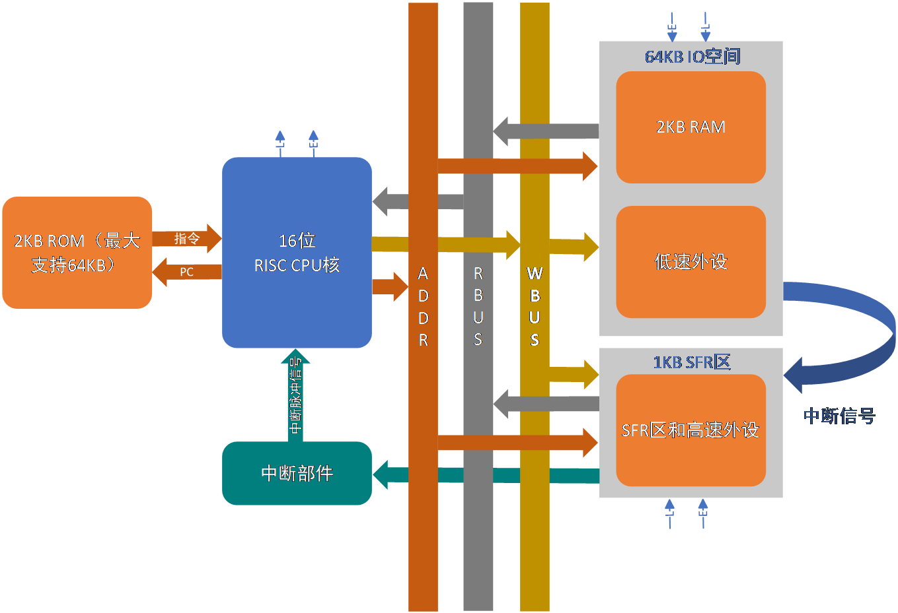
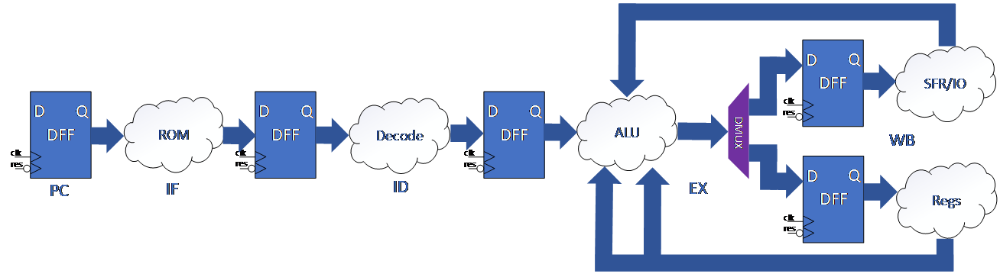
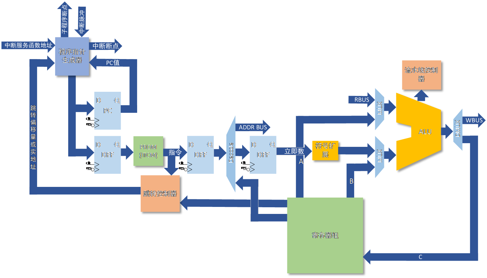
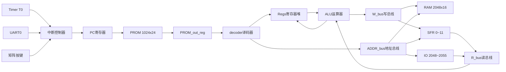
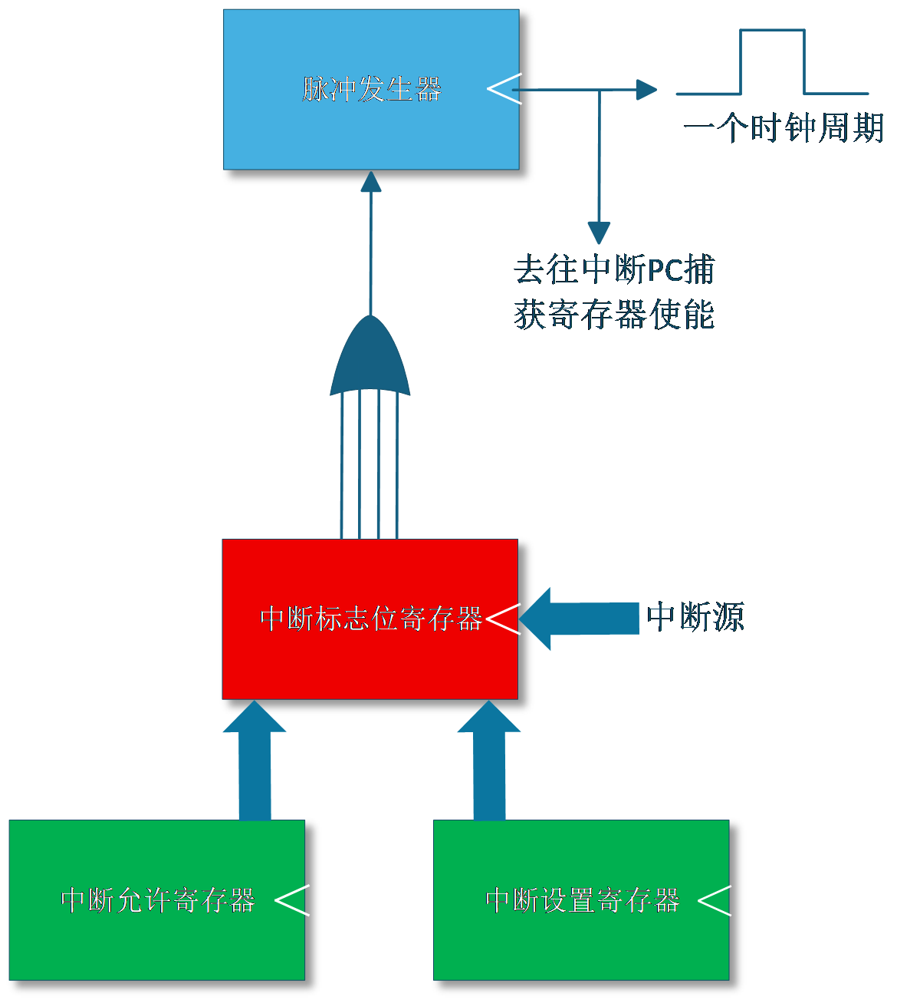
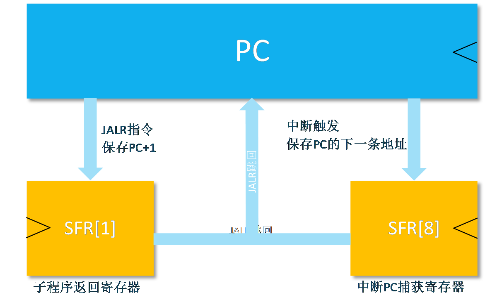
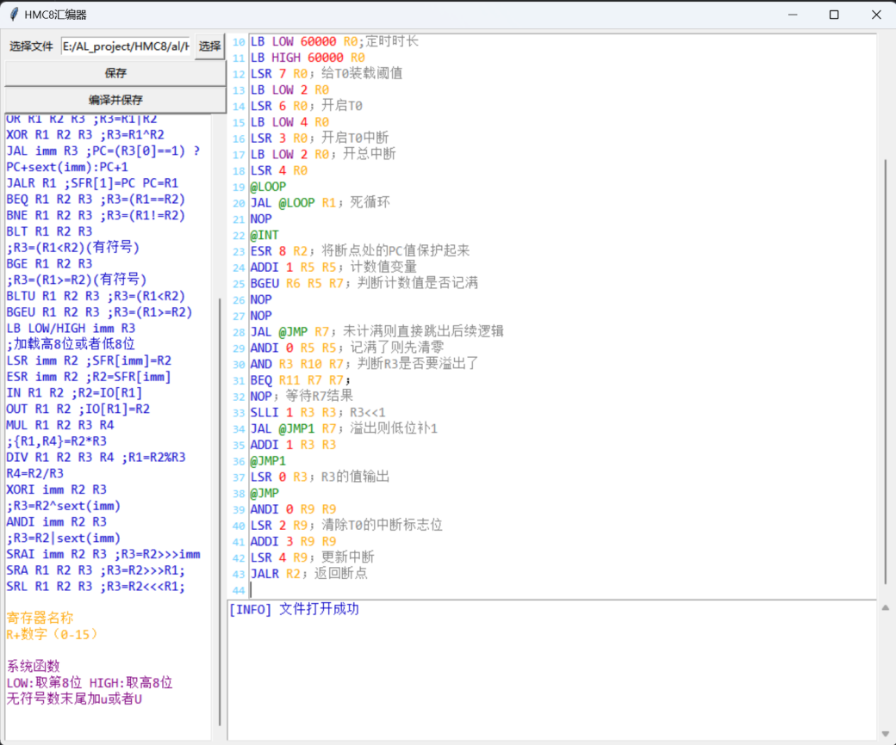
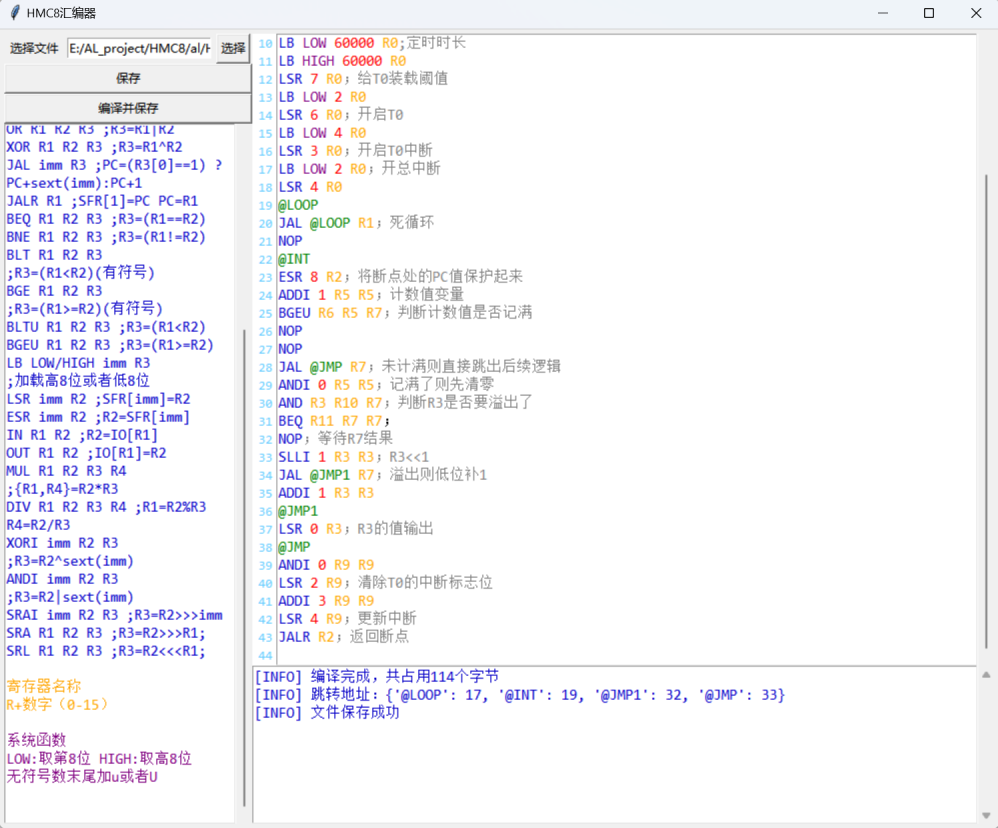

# HMC8——16位自研指令集RISC处理器与片上系统

> 一套从指令集、汇编器到RTL全部自研的16位模型机，已在安路EG4与Altera Cyclone IV E两个平台上完成综合布线，并用定时器中断、矩阵按键、数码管等汇编程序完成板级验证。


## 目录

- [一、作品概述](#一作品概述)
- [二、目录结构](#二目录结构)
- [三、系统架构](#三系统架构)
- [四、外设与中断](#四外设与中断)
- [五、指令集](#五指令集)
- [六、工具链：汇编器](#六工具链汇编器)
- [七、快速开始](#七快速开始)
- [八、验证情况](#八验证情况)
- [九、已知约束与坑](#九已知约束与坑)
- [十、常见问题排查](#十常见问题排查)
- [十一、文档索引](#十一文档索引)
- [十二、后续计划](#十二后续计划)
- [十三、团队分工](#十三团队分工)
- [十四、参考资料](#十四参考资料)
- [十五、开源协议](#十五开源协议)

## 一、作品概述

### 1.1简介

HMC8是一台自己定义指令集、自己实现硬件的16位处理器。它不基于任何现成软核，指令集、编码格式、微架构、汇编器与工具链均为独立设计。

设计目标是一台"能写程序、能上板、能在两个不同厂商的FPGA上跑起来"的完整小机器，因此取舍上明显偏向**小面积+结构清晰**：乘除法用串行移位迭代实现（不占DSP块），程序与数据分开存放在PROM与RAM中，外设统一挂在特殊功能寄存器（SFR）与IO两个地址空间上，中断走一个共用向量加软件查询的结构。

目前状态：RTL、汇编器、两个平台的工程与仿真流程均已打通。`al/HMC8/asm/`下已积累闪灯、流水灯、数码管、矩阵按键、数字时钟、串口回传、命令解析、密码锁等例程，其中闪灯与流水灯已明确完成板级验证，其余例程在`汇编注意事项.txt`中留有板上实测记录。



### 1.2主要性能指标

| 项目 | 指标 |
| --- | --- |
| 系统时钟 | 50MHz |
| 数据位宽 | 16位 |
| 指令位宽 | 24位 |
| 指令条数 | 33条定长指令 |
| 程序存储器 | PROM 1024×24（片内BRAM，可扩至64K×24） |
| 数据存储器 | RAM 2048×16（片内BRAM，可扩至64K×16） |
| 特殊寄存器 | 12个16位SFR（地址0~11），紧耦合于CPU |
| IO地址空间 | 2048~2055，映射矩阵按键与数码管 |
| 中断源 | 6路：软件中断S0/S1、按键、定时器T0、UART0接收、UART0发送 |
| 中断响应 | 最大约220ns；级数由软件设定，建议不超过4级 |
| 定时器 | T0，4挡分频，定时范围20ns~5.24ms |
| 串口 | UART0，9600bps，收发各带中断标志 |
| 乘法 | 串行移位加法，9拍完成，无符号16位 |
| 除法 | 串行恢复余数法，9拍完成，无符号16位 |
| 外设 | UART、Timer、4×4矩阵按键、4位数码管，另预留PWM模块 |
| 资源占用 | CPU核约667LE（安路EG4综合结果，详见作品报告） |
| 可移植性 | 同一套RTL，用`ip_sel`参数切换Altera/安路两种IP例化方式 |

### 1.3主要创新点

- **全链路自研**：CPU微架构、指令集、汇编器三层均为独立设计，而非在现成软核上二次开发。
- **两级寻址空间**：按访问速度把外设分成SFR区（紧耦合、单拍直达）与IO区（经地址总线、同步读写），实现内核控制与外设空间的分离。
- **轻量中断**：借鉴PIC单片机的思路，把6路中断源合成一个脉冲送给CPU，进入服务程序后用软件查询标志位判定中断源。硬件简单，优先级由软件灵活设定。
- **紧耦合乘除法器**：串行结构仅耗约400门乘法器与200门除法器，免去软件模拟，复杂运算提速明显。
- **跳转与子程序机制重构**：在借鉴RISC-V设计思想的基础上，按实际硬件框架重新设计了`JAL`/`JALR`，一条`JALR`即可完成子程序跳转与跳回。

## 二、目录结构

```
HMC8/
├─ altera/                     #Altera（Cyclone IV E）工程
│  ├─ HMC8.qpf / HMC8.qsf      #Quartus工程与设置
│  ├─ HMC8.out.sdc             #时序约束（50MHz）
│  ├─ PROM.mif                 #程序存储器初始化文件（汇编器输出）
│  ├─ ip/                      #altsyncram生成的PROM/RAM
│  ├─ sim/                     #测试台与仿真脚本
│  └─ src/                     #设计源码（与安路工程共用同一份）
│
├─ al/HMC8/                    #安路（EG4）工程，板级验证平台
│  ├─ HMC8.al                  #TD工程文件
│  ├─ HMC8.sdc                 #时钟约束
│  ├─ IO_pin.adc               #引脚分配（当前版本，含按键与数码管）
│  ├─ IO_constant.adc          #早期引脚分配（不含按键与数码管，仅备份）
│  ├─ al_PROM.mif              #程序存储器初始化文件（汇编器输出）
│  ├─ ip/                      #安路IP生成的PROM/RAM（例化EG_LOGIC_BRAM）
│  ├─ asm/                     #板级验证用的汇编源码
│  ├─ sim/                     #测试台与RTL仿真脚本
│  └─ HMC8_Runs/               #TD生成的综合/布局布线结果（不入库）
│
├─ asm/                        #汇编器与汇编源码
│  ├─ 汇编程序.txt             #指令集各功能测试程序
│  ├─ 子程序跳转.txt           #子程序与JALR用法示例
│  ├─ 软件中断.txt             #软件中断用法示例
│  └─ HMC8汇编器/
│     ├─ HMC4.1汇编器.py       #汇编器主程序（GUI）
│     ├─ ISA.py                #指令表：助记符、操作码、正则
│     ├─ my_tkui.py            #自研tkinter控件库
│     └─ HMC4.1汇编器.spec     #PyInstaller打包配置
│
└─ doc/
   ├─ 作品报告.docx            #作品报告原件（不入库，以PDF形式提交）
   ├─ figures/                 #从报告导出的框图，GitHub可直接预览
   ├─ HMC8绘图/                #Visio绘图源文件与部分PNG
   └─ riscv/                   #ISA设计时整理的RISC-V参考资料
```

设计源码统一放在`altera/src/`，两个平台共用；安路工程通过相对路径`../../altera/src/*.v`引用同一份文件，避免了两份RTL分叉。

## 三、系统架构

### 3.1模块划分

| 文件 | 功能 | 关键点 |
| --- | --- | --- |
| `HMC8_SOC.v` | 顶层：RAM、SFR、中断控制器、定时器、UART、按键、数码管实例化 | 用`ip_sel`参数切换两家IP |
| `HMC8.v` | 处理器核心：PC、流水线寄存器、寄存器堆与ALU互连 | 含PROM例化与PC选择逻辑 |
| `decoder.v` | 译码器：生成全部控制信号 | 所有输出为寄存输出，与流水相相位对齐 |
| `ALU.v` | 运算器：算术、逻辑、移位、比较、乘除调度 | 乘除结果优先于操作码译码 |
| `Regs.v` | 16×16位寄存器堆 | 双写口，支持半字写（`LB`） |
| `MUL_serial.v` | 串行乘法器 | 每拍2位，8拍出结果 |
| `DIV_serial.v` | 串行除法器 | 恢复余数法，每拍2位 |
| `pip_control.v` | 流水线停滞控制 | 乘除期间拉低`en`冻结流水线 |
| `jmp_control.v` | 跳转目标与返回地址计算 | 同时输出`PC_CH`供中断捕获 |
| `Timer.v` | T0定时器 | 分频、计数、溢出脉冲 |
| `UART_send.v` | 串口发送 | 9600bps，按50MHz时钟分频 |
| `UART_receive.v` | 串口接收 | 9600bps，起始位检测与移位采样 |
| `key.v` | 4×4矩阵按键扫描 | 消抖后输出键值与按键中断`KI` |
| `dig.v` | 4位数码管动态扫描 | 内含七段译码表，输入为数值0~9 |
| `pwm.v` | PWM发生器 | 已编写，尚未接入顶层 |

### 3.2顶层端口

| 端口 | 方向 | 位宽 | 说明 |
| --- | --- | --- | --- |
| `clk` | 输入 | 1 | 系统时钟，要求50MHz |
| `res_n` | 输入 | 1 | 异步复位，低有效 |
| `out` | 输出 | 16 | 输出寄存器`SFR[0]`，接LED |
| `RX` / `TX` | 输入/输出 | 1 | UART0收发 |
| `key_col` | 输入 | 4 | 矩阵按键列输入 |
| `key_row` | 输出 | 4 | 矩阵按键行输出 |
| `DigitronCS_Out` | 输出 | 4 | 数码管位选 |
| `Digitron_Out` | 输出 | 8 | 数码管段选 |

### 3.3流水线与数据通路

指令沿「`PC`→PROM同步读出→`PROM_out_reg`→译码器寄存输出→ALU/写回」逐级推进，对应作品报告中按IF/ID/EX/WB表述的四级流水线（其中写回与访存合并在同一节拍完成）。乘除法属于多周期单元，执行期间`pip_control`拉低`en`冻结PC与流水线寄存器，等`finish`到达后写回结果。







### 3.4地址空间

| 范围 | 归属 | 说明 |
| --- | --- | --- |
| 0~1023 | PROM | 程序存储器，24位宽，由`PC_mux`驱动 |
| 0~2047 | RAM | 数据存储器，`L=1`且`SFR_wr=0`时写入 |
| 0~11 | SFR | 特殊功能寄存器，由`LSR`/`ESR`访问 |
| 2048~2055 | IO | 低速外设：矩阵按键与数码管 |
| 2056及以后 | IO | 保留给后续外设扩展 |

读总线`R_bus`的选择规则：`SFR_wr=1`时读SFR；否则地址小于2048读RAM；再否则读IO。

两级寻址的意义在于速度分层：SFR区紧耦合于CPU，`LSR`/`ESR`单拍完成，不需要`NOP`间隔；IO区经地址总线与同步BRAM，存在流水延迟，因此软件上必须按[九、已知约束与坑](#九已知约束与坑)中的规则连写多条`IN`/`OUT`。

## 四、外设与中断

### 4.1中断源与寄存器

中断标志与使能共用一个6位布局，标志在`SFR[2]`，使能在`SFR[3]`：

| 位 | 中断源 | 置位条件 |
| --- | --- | --- |
| 5 | 矩阵按键 | `KI`脉冲且`SFR[3][5]=1` |
| 4 | S1软件中断 | 软件写`SFR[2][4]` |
| 3 | S0软件中断 | 软件写`SFR[2][3]` |
| 2 | T0定时器溢出 | `TI0`脉冲且`SFR[3][2]=1` |
| 1 | UART0接收完成 | `RI`且`SFR[3][1]=1` |
| 0 | UART0发送完成 | `TI`且`SFR[3][0]=1` |

中断相关寄存器：

| SFR | 用途 | 关键位 |
| --- | --- | --- |
| `SFR[2]` | 中断标志 | 见上表；写0可清标志 |
| `SFR[3]` | 中断使能 | 见上表，逐位使能 |
| `SFR[4]` | 中断控制 | bit1=总中断允许（`IF`）；bit0=清边沿检测（写1，硬件自动只保持一拍） |
| `SFR[5]` | 中断服务程序入口地址 | 16位向量 |
| `SFR[8]` | 中断返回地址 | 中断被接受那一拍自动捕获，只读 |

### 4.2中断响应流程

1. 某个标志置位且对应使能位为1，`I=|SFR[2]`上升沿被检测到；
2. 若总中断允许（`SFR[4][1]=1`），下一拍`PC`跳到`SFR[5]`，同时把"本来该执行的下一条指令地址"写进`SFR[8]`；
3. 服务程序开头用`ESR 8 Rx`取回返回地址，保存到通用寄存器；
4. 处理完先清中断源（写`SFR[2]`对应位为0），再写`SFR[4]=3`清除边沿检测并保持总中断允许；
5. `JALR Rx`返回断点。

第4步的顺序很关键：**必须先清中断源，再清边沿检测**。如果先清了边沿检测而源标志还在，会立刻再触发一次中断。

多个中断源共用`SFR[5]`一个入口时，服务程序必须逐个检查所有源，不能处理一个就直接返回，否则其他标志会被一起清掉。



### 4.3 PC保存逻辑

子程序跳转与中断响应保存返回地址的位置不同，这是阅读代码时最容易混淆的一点：



| 场景 | 返回地址存放位置 | 触发时机 |
| --- | --- | --- |
| 子程序调用（`JALR`） | `SFR[1]` | `JALR`执行时自动捕获`PC+1` |
| 中断响应 | `SFR[8]` | 中断被接受那一拍捕获`PC_CH` |

### 4.4定时器T0

| 寄存器 | 位 | 含义 |
| --- | --- | --- |
| `SFR[6]` | 0 | 计数器清零（电平有效，写1期间计数保持0） |
| `SFR[6]` | 1 | 定时器使能 |
| `SFR[6]` | 3:2 | 分频系数，实际分频为`{SFR[6][3:2]}+1` |
| `SFR[6]` | 4 | 溢出标志，由硬件置1，写0清除 |
| `SFR[7]` | 15:0 | 计数阈值`val` |

中断周期为`(val+1)×(分频系数)`个时钟。以50MHz、`val=60000`、不分频为例，中断周期约1.2ms，闪灯例程每100次中断翻转一次，约120ms更新一次LED。

注意`val=0`时计数器停在0，溢出标志只在第一次置位，不会周期性产生中断。

### 4.5 UART0

| 寄存器 | 位 | 含义 |
| --- | --- | --- |
| `SFR[9]` | 0 | 发送使能，写1启动一次发送，硬件自动清零 |
| `SFR[9]` | 1 | 接收使能 |
| `SFR[9]` | 2 | 发送忙标志（只读） |
| `SFR[10]` | 7:0 | 发送数据 |
| `SFR[11]` | 7:0 | 接收数据 |

波特率由`UART_send.v`/`UART_receive.v`顶部的`parameter Baud=9600`与`parameter sys_clk=50_000_000`决定。**这两个参数必须与实际输入时钟一致**：如果板上晶振不是50MHz，需要同步修改，否则收发波特率会成比例偏差。

发送流程：写`SFR[10]`装数据，再写`SFR[9][0]=1`启动；发送完成产生`TI`脉冲，可触发中断。
接收流程：写`SFR[9][1]=1`使能接收；收到完整字节产生`RI`脉冲，数据在`SFR[11]`。

只需发送时写`SFR[9]=1`，不要写3。写3会同时打开接收使能，RX引脚上的毛刺会频繁触发`RI`中断，打乱定时器计数。

### 4.6矩阵按键与数码管

两者都挂到IO空间，通过`IN`/`OUT`访问：

| IO地址 | 偏移 | 用途 | 说明 |
| --- | --- | --- | --- |
| 2048 | `IO[0]` | 按键使能 | 写1开启，误写0会让按键永久失效 |
| 2049 | `IO[1]` | 按键键值 | 键值=行号×4+列号 |
| 2050~2053 | `IO[2]~IO[5]` | 数码管4位数据 | 从左到右，装数值0~9，不是七段码 |
| 2054 | `IO[6]` | 数码管小数点 | bit0~bit3对应4位 |
| 2055 | `IO[7]` | 数码管使能 | bit0必须写1，否则全灭 |

`dig.v`内部自带译码表，所以软件写的是**数值**而不是七段码。装63之类的非法值会命中`default`分支直接熄灭。

### 4.7 PWM（预留）

`pwm.v`已实现（`freq_div`分频、`duty`占空比、`cnt`周期阈值、`en`使能），但当前版本**尚未在`HMC8_SOC.v`中例化**，因此没有对应的SFR/IO地址。若需使用，需在顶层补实例化并分配寄存器。

## 五、指令集

### 5.1指令表

立即数型指令的`imm`为10位：`ADDI`/`SLTI`/`XORI`/`ORI`/`ANDI`做符号扩展，`SLLI`/`SRLI`/`SRAI`做零扩展。

| 助记符 | 操作码 | 格式 | 汇编语法 | 语义 |
| --- | --- | --- | --- | --- |
| `NOP` | 0 | nop | `NOP` | 空操作 |
| `ADDI` | 1 | imm | `ADDI imm R2 R3` | `R3=R2+sext(imm)` |
| `SLTI` | 2 | imm | `SLTI imm R2 R3` | `R3=(R2<sext(imm))?1:0`（有符号） |
| `SLLI` | 3 | imm | `SLLI imm R2 R3` | `R3=R2<<imm` |
| `SRLI` | 4 | imm | `SRLI imm R2 R3` | `R3=R2>>imm` |
| `ADD` | 5 | r | `ADD R1 R2 R3` | `R3=R1+R2` |
| `SUB` | 6 | r | `SUB R1 R2 R3` | `R3=R1-R2` |
| `SLL` | 7 | r | `SLL R1 R2 R3` | `R3=R1<<R2` |
| `SRL` | 8 | r | `SRL R1 R2 R3` | `R3=R1>>R2` |
| `AND` | 11 | r | `AND R1 R2 R3` | `R3=R1&R2` |
| `OR` | 12 | r | `OR R1 R2 R3` | `R3=R1\|R2` |
| `XOR` | 13 | r | `XOR R1 R2 R3` | `R3=R1^R2` |
| `JAL` | 14 | jal | `JAL @标签 R3` | `R3[0]=1`时`PC=PC+off`，否则`PC=PC+1` |
| `JALR` | 15 | jalr | `JALR R1` | 无条件跳转到`R1`，返回地址存`SFR[1]` |
| `BEQ` | 16 | r | `BEQ R1 R2 R3` | `R3=(R1==R2)?1:0` |
| `BNE` | 17 | r | `BNE R1 R2 R3` | `R3=(R1!=R2)?1:0` |
| `BLT` | 18 | r | `BLT R1 R2 R3` | `R3=(R1<R2)?1:0`（有符号） |
| `BGE` | 19 | r | `BGE R1 R2 R3` | `R3=(R1>=R2)?1:0`（有符号） |
| `BLTU` | 20 | r | `BLTU R1 R2 R3` | `R3=(R1<R2)?1:0`（无符号） |
| `BGEU` | 21 | r | `BGEU R1 R2 R3` | `R3=(R1>=R2)?1:0`（无符号） |
| `LB` | 22 | lb | `LB LOW\|HIGH 数值 R3` | 取低8位或高8位装入寄存器 |
| `LSR` | 23 | lsr | `LSR imm R2` | `SFR[imm]=R2` |
| `ESR` | 24 | esr | `ESR imm R2` | `R2=SFR[imm]` |
| `IN` | 25 | in | `IN R1 R2` | `R2=RAM[R1]` |
| `OUT` | 26 | out | `OUT R1 R2` | `RAM[R1]=R2` |
| `MUL` | 27 | md | `MUL R1 R2 R3 R4` | `{R1,R4}=R2*R3`（无符号） |
| `DIV` | 28 | md | `DIV R1 R2 R3 R4` | `R1=R2%R3`，`R4=R2/R3`（无符号） |
| `XORI` | 29 | imm | `XORI imm R2 R3` | `R3=R2^sext(imm)` |
| `ORI` | 30 | imm | `ORI imm R2 R3` | `R3=R2\|sext(imm)` |
| `ANDI` | 31 | imm | `ANDI imm R2 R3` | `R3=R2&sext(imm)` |
| `SRAI` | 32 | imm | `SRAI imm R2 R3` | `R3=R2>>>imm` |
| `SRA` | 33 | r | `SRA R1 R2 R3` | `R3=R1>>>R2`（算术右移） |
| `SLA` | 34 | r | `SLA R1 R2 R3` | `R3=R1<<R2`（算术左移，位级与`SLL`等价） |

### 5.2编码格式

指令字24位，高6位为操作码，其余字段按格式划分：

| 格式 | 字段（高位:低位） |
| --- | --- |
| imm | op[23:18] imm[17:8] a[7:4] c[3:0] |
| r | op[23:18] b[11:8] a[7:4] c[3:0] |
| nop | op[23:18] |
| lb | op[23:18] byte[17:8] hi[4] r[3:0] |
| lsr | op[23:18] idx[17:8] a[7:4] |
| esr | op[23:18] idx[17:8] c[3:0] |
| in | op[23:18] b[11:8] c[3:0] |
| out | op[23:18] b[11:8] a[7:4] |
| md | op[23:18] d[15:12] b[11:8] a[7:4] c[3:0] |
| jal | op[23:18] off[17:4] cond[3:0] |
| jalr | op[23:18] f[7:4] |

其中`a`/`b`是源寄存器，`c`/`d`是目的寄存器（`LB`半字写与乘除双写口会同时用到两个目的寄存器）。

### 5.3指令级注意事项

| 事项 | 说明 |
| --- | --- |
| 乘除后必须跟`NOP` | 详见第九节；汇编时把`NOP`放在`MUL`/`DIV`的下一条 |
| `MUL`/`DIV`为无符号 | 有符号运算需软件自行处理符号 |
| 除零未定义 | 除数为0时结果无意义，程序需自行判断 |
| `JAL`条件寄存器需提前设置 | 条件寄存器至少提前2条指令写好，不能紧邻 |
| 移位量超过15按硬件语义处理 | `<<`/`>>`在移位量≥16时为0，`>>>`为全符号位 |
| `LB`的`LOW`/`HIGH` | 两次写同一寄存器，先`LOW`后`HIGH` |

## 六、工具链：汇编器

### 6.1启动方式

```
asm/HMC8汇编器/HMC4.1汇编器.py
```

用Python 3运行（依赖标准库`tkinter`与`re`，无需额外安装包）。界面右上为带语法高亮的编辑区，右下为日志区，左侧为指令说明，左上为`保存`与`编译并保存`按钮。



### 6.2汇编语法

| 语法 | 说明 |
| --- | --- |
| `;`或`；` | 行注释，行内注释同样支持 |
| `@标签` | 跳转地址标签，单独占一行 |
| `R0`~`R15` | 通用寄存器 |
| `10`、`-37`、`300U` | 立即数，支持有符号与`U`后缀 |
| `LOW`/`HIGH` | `LB`指令的字节选择 |

编写汇编程序前建议先读`al/HMC8/asm/汇编注意事项.txt`，那份文件按"写代码前必读"的顺序整理了全部语法规则与踩坑记录。

### 6.3输出

汇编结果是Quartus/安路都能读的MIF文件，头部固定为`WIDTH=24`、`DEPTH=1024`。把生成的MIF覆盖到工程对应位置即可：

| 平台 | 目标文件 |
| --- | --- |
| Altera | `altera/PROM.mif` |
| 安路 | `al/HMC8/al_PROM.mif` |



### 6.4已知待修

汇编器界面里的指令说明文本（`order_show`）还有两处与RTL不一致，以本README第五节为准：

- `ANDI`一行写成了`R3=R2|sext(imm)`，应为`&`；
- `SRA`一行操作数顺序写反，且末尾多一个分号；另有一行残留的`SRL ... R3=R2<<<R1`实际描述的是`SLA`。

## 七、快速开始

### 7.1环境依赖

| 用途 | 工具 | 版本 |
| --- | --- | --- |
| 安路平台综合与下载 | 安路TD | 5.6 |
| Altera平台综合与下载 | Quartus Prime Standard | 17.1 |
| RTL仿真 | ModelSim / Questa | 任意支持Verilog-2001的版本 |
| 汇编器 | Python | 3.8及以上 |

### 7.2安路EG4（板级验证平台）

1. 用TD打开`al/HMC8/HMC8.al`；
2. 用汇编器编译源程序，把生成的MIF另存为`al/HMC8/al_PROM.mif`；
3. 运行综合与布局布线，生成bitstream；
4. 下载到EG4S20BG256板卡。

当前引脚分配见`al/HMC8/IO_pin.adc`：

| 信号 | 引脚 | 信号 | 引脚 |
| --- | --- | --- | --- |
| `clk` | R7 | `res_n` | E3 |
| `RX` | L12 | `TX` | M11 |
| `out[0]` | F3 | `out[8]` | D1 |
| `out[1]` | G3 | `out[9]` | E1 |
| `out[2]` | H4 | `out[10]` | F1 |
| `out[3]` | H5 | `out[11]` | H2 |
| `out[4]` | K3 | `out[12]` | J1 |
| `out[5]` | K6 | `out[13]` | K2 |
| `out[6]` | L4 | `out[14]` | L5 |
| `out[7]` | M3 | `out[15]` | M4 |
| `key_col[0]` | E11 | `key_row[0]` | E10 |
| `key_col[1]` | D11 | `key_row[1]` | C10 |
| `key_col[2]` | C11 | `key_row[2]` | F9 |
| `key_col[3]` | F10 | `key_row[3]` | D9 |
| `DigitronCS_Out[0]` | C9 | `Digitron_Out[0]` | A4 |
| `DigitronCS_Out[1]` | B6 | `Digitron_Out[1]` | A6 |
| `DigitronCS_Out[2]` | A5 | `Digitron_Out[2]` | B8 |
| `DigitronCS_Out[3]` | A3 | `Digitron_Out[3]` | E8 |
| `Digitron_Out[4]` | A7 | `Digitron_Out[5]` | B5 |
| `Digitron_Out[6]` | A8 | `Digitron_Out[7]` | C8 |

`out[15:0]`即`SFR[0]`，接板上LED；晶振需为50MHz（UART分频参数依赖它）。

`IO_constant.adc`是早期版本（`LVCMOS25`电平、`RX`/`TX`在F12/D12、无按键与数码管），仅作历史备份，不要与新板卡混用。

### 7.3 Altera Cyclone IV E

1. 用Quartus Prime 17.1打开`altera/HMC8.qpf`；
2. 汇编器输出另存为`altera/PROM.mif`；
3. 编译并下载。

注意两点：工程内`ip_sel`默认为1，走的是`altsyncram`例化；引脚位置尚未固定（`HMC8.qsf`里没有`set_location_assignment`），**上板前需要先按实际板子补引脚约束**。

### 7.4双平台共用一个源码目录

`altera/src/`是唯一一份RTL，安路工程用相对路径`../../altera/src/*.v`引用。切换平台只需要改顶层参数：

```verilog
parameter ip_sel=0;   // 0=安路（EG_LOGIC_BRAM），1=Altera（altsyncram）
```

### 7.5 RTL仿真

**安路平台（ModelSim）**：在`al/HMC8/sim/`目录下执行：

```bat
F:\FPGAIDE\modelsim_ase\win32aloem\vsim.exe -c -do "do rtl_sim.do; run 2us; quit -f"
```

`rtl_sim.do`会自动把`../al_PROM.mif`转成`al_PROM.hex`，编译RTL与仿真存储器模型后加载。三个必须注意的点：

1. **必须在`sim/`目录下运行**，因为IP的初始化路径写成`INIT_FILE("../al_PROM.mif")`，是相对仿真工作目录解析的；
2. **顶层必须写testbench名`HMC8_SOC_tb`**。TD自动生成的`HMC8_Runs/phy_1/simulation/HMC8_phy_sim.do`里这一格是空的，直接跑会报`Could not find work.<NULL>`；
3. 仿真时用`sim_mem.v`代替`ip/PROM.v`与`ip/RAM.v`，不要同时编译（模块重名）。安路的`EG_LOGIC_BRAM`模型是加密的，在本工程里读不到`INIT_FILE`，PROM会输出`x`并导致流水线X传播锁死。

要看综合后网表仿真，直接用TD生成的`HMC8_Runs/phy_1/simulation/HMC8_phy_sim.v`，那份网表里BRAM初值以`INITP_00`/`INIT_00`参数内嵌，不需要MIF。

**Altera平台（ModelSim）**：用Quartus的`Tools → Run Simulation Tool → RTL Simulation`，或直接执行`altera/simulation/modelsim/HMC8_run_msim_rtl_verilog.do`。`altera/sim/tb_jump_trace.v`是逐拍打印PC与全部寄存器的调试用测试台，配合`run_jump_trace.do`可以在跳转类问题里直接看到译码器正在处理哪条指令。

## 八、验证情况

### 8.1板级验证状态

| 功能 | 验证例程 | 状态 |
| --- | --- | --- |
| 定时器T0中断、中断返回、SFR读写 | `al/HMC8/asm/闪灯.txt` | 已通过板级验证 |
| 定时器中断+移位运算+轮回输出 | `al/HMC8/asm/流水灯.txt` | 已通过板级验证 |
| `LB`高低字节装载、`ADDI`/`ANDI`/`AND`/`SLLI` | 同上 | 已通过板级验证 |
| `BGEU`/`BEQ`条件跳转、`JAL`/`JALR` | 同上 | 已通过板级验证 |
| 数码管动态扫描与七段译码 | `al/HMC8/asm/数码管.txt` | 例程已入库，`汇编注意事项.txt`有实测记录 |
| 4×4矩阵按键扫描与按键中断 | `al/HMC8/asm/矩阵按键.txt` | 例程已入库，`汇编注意事项.txt`有实测记录 |
| 定时器计时+数码管显示 | `al/HMC8/asm/数字时钟.txt` | 例程已入库 |
| UART接收与回传 | `al/HMC8/asm/串口回传.txt` | 例程已入库，`汇编注意事项.txt`有实测记录 |
| UART命令解析与执行 | `al/HMC8/asm/串口命令解析.txt` | 例程已入库 |
| 按键输入+数码管显示+密码比对 | `al/HMC8/asm/密码锁.txt` | 例程已入库 |
| `MUL`/`DIV`、`IN`/`OUT` | `asm/汇编程序.txt`中的用例 | 仿真验证，上板记录待补 |

表内两种状态的判定依据：「已通过板级验证」指实际烧录到EG4板卡并观察到预期现象；「例程已入库，`汇编注意事项.txt`有实测记录」指对应例程已在仓库中，且该文件以「实测/坑」条目记录了板上观察到的现象，但未在本文档中单独归档波形与照片。完整的验证记录以作品报告为准。

### 8.2仿真验证

- **子程序机制**：`asm/子程序跳转.txt`配合`altera/sim/tb_jump_trace.v`逐拍比对PC与`SFR[1]`。
  仿真时序图见[`doc/figures/16-子程序仿真时序.png`](doc/figures/16-子程序仿真时序.png)。
- **软件中断**：`asm/软件中断.txt`验证`SFR[3]`/`SFR[4]`配置、`SFR[8]`捕获与`JALR`返回。
  时序图见[`doc/figures/18-软件中断执行时序.png`](doc/figures/18-软件中断执行时序.png)。
- **整机回归**：`asm/汇编程序.txt`覆盖算术、逻辑、移位、比较、内存访问等指令。

## 九、已知约束与坑

这些是调试过程中确认过的硬件行为，写程序与改RTL时都要留意。

| 项 | 现象与约束 | 依据 |
| --- | --- | --- |
| `IN`必须连写三次，`OUT`连写两次 | `ADDR_bus`是译码器里的非阻塞寄存器，RAM是同步读BRAM，地址比指令慢一拍、数据又比地址慢一拍，所以前两次读到的都是旧值 | 实测 |
| 不要用`RAM[0]`存关键数据 | 读地址0会读到错误内容，实测把BCD数字放`RAM[0..3]`时读到的是`RAM[3]`的值 | 实测 |
| 写IO前要预热地址 | 未预热时第一次`OUT`可能误写`IO[0]`，把按键使能关掉 | 实测 |
| 乘除后必须紧跟`NOP` | 紧跟`MUL`/`DIV`的那条指令会被"占用"，读-改-写类指令会重复执行（实测`ADDI 1 R10 R10`被加了9次） | 实测 |
| 停滞期间重复写 | 流水线停滞时译码器输出被冻结，寄存器堆仍每拍写入，读-改-写指令执行次数等于停滞拍数 | 实测 |
| `JAL`条件寄存器需提前 | 条件寄存器与`JAL`相隔至少2条指令写；紧邻写入时`JAL`读到旧值，该跳不跳 | 实测 |
| `LB`只写半个字 | `LB LOW`只改低8位、高8位保持原值；装大于255的数必须`LOW`与`HIGH`两条配对 | 实测 |
| 立即数只有10位 | `ADDI`等立即数型指令范围-512~+511，超出会被截断（`ADDI 1024 R14 R3`实际变成加0） | 实测 |
| 中断清标志的顺序 | 必须先清中断源（`SFR[2]`对应位），再写`SFR[4]`清边沿检测 | 代码逻辑 |
| 停滞期间的中断 | 中断请求在乘除法停滞期间会被保持到停滞结束，响应延迟会叠加停滞时间 | 实测 |
| 定时器不受停滞影响 | T0计数只受`SFR[6]`控制，与流水线`en`无关，因此它是停滞期间唯一能到点的中断源 | 代码逻辑 |
| 乘除为无符号、除零未定义 | 有符号与除零需软件处理 | 代码逻辑 |
| UART依赖50MHz | `UART_send.v`/`UART_receive.v`的分频参数按50MHz计算 | 代码 |
| 复位为异步低有效 | `res_n`经两级同步器产生内部`res`，外部只需保证上电期间拉低足够长 | 代码 |
| Altera侧引脚未固定 | `HMC8.qsf`无引脚位置约束，每次编译引脚可能变化 | 工程设置 |

### 寄存器使用约定

多人协作写汇编时按下面的分配避免相互踩踏：

| 寄存器 | 预定用途 |
| --- | --- |
| `R0`/`R1` | 常量0与1，不要当作`IN`/`OUT`的地址 |
| `R2` | 中断专用：`LSR`数据源 |
| `R3` | 主循环专用：外设地址 |
| `R4` | 中断专用：`ESR`读出的SFR数据 |
| `R5` | 主循环专用：`IN`读出的数据 |
| `R9`/`R11` | 主循环专用：工作地址与判断结果 |
| `R8`/`R10`/`R12`/`R15` | 中断专用：计数器、判断结果、断点、地址临时 |

## 十、常见问题排查

| 现象 | 可能原因 |
| --- | --- |
| 板子上电后LED毫无变化 | PROM未正确初始化（MIF路径不对或未重新生成IP）；复位未释放；中断未开（`SFR[4][1]`） |
| 中断只进一次就不再进 | 没有清中断源，或先清了边沿检测；T0阈值写成了0 |
| 计数/累加结果偏大若干倍 | 紧跟乘除法的那条读-改-写指令被重复执行，需在乘除后补`NOP` |
| 条件跳转方向不对 | 条件寄存器与`JAL`相邻，读到了旧值 |
| 数码管最高位显示的是最低位的数 | 用了`RAM[0]`存数据，改存到`RAM[4]`之后 |
| 数码管一点不亮 | 漏写`IO[7]=1`；或装了七段码而不是数值0~9 |
| 按键完全无反应 | 误写了`IO[0]`把使能关掉；或中断服务程序处理完T0就返回，把按键标志一起清掉了 |
| UART乱码 | 板上时钟不是50MHz，或波特率参数未同步修改；写`SFR[9]=3`带起了接收使能引入毛刺 |
| ModelSim报`Could not find work.<NULL>` | 仿真顶层名为空，改成`work.HMC8_SOC_tb` |
| ModelSim里PROM读出`x` | 原始RTL直接例化安路加密BRAM模型，用`sim_mem.v`代替 |
| 汇编点了编译没反应 | 源文件里的空行会让汇编器抛`IndexError`，先查空行 |
| 综合后功能异常但仿真正常 | 检查乘除与中断的时序约束，以及是否触发了上面几条停滞相关约束 |

## 十一、文档索引

| 文档 | 位置 | 说明 |
| --- | --- | --- |
| 作品报告（PDF） | `doc/作品报告.pdf` | 完整技术文档。**待导出**：用Word打开`doc/作品报告.docx`，另存为PDF后放入`doc/`；`.docx`原件不入库 |
| 框图与截图 | [`doc/figures/`](doc/figures/) | 从作品报告导出的26张图，GitHub可直接预览 |
| Visio绘图源文件 | [`doc/HMC8绘图/`](doc/HMC8绘图/) | 各模块框图的`.vsdx`源文件，便于二次修改 |
| 汇编规则总表 | [`al/HMC8/asm/汇编注意事项.txt`](al/HMC8/asm/汇编注意事项.txt) | 写汇编前必读，按"写代码前必读"的顺序排列 |
| RISC-V参考资料 | [`doc/riscv/`](doc/riscv/) | ISA设计时整理的RISC-V指令集资料 |

`doc/figures/`中的图片按报告顺序编号，与报告图注一一对应：

| 序号 | 内容 | 序号 | 内容 |
| --- | --- | --- | --- |
| 01 | 设计流程 | 14 | 跳转型指令执行 |
| 02 | 系统整体结构 | 15 | 子程序测试程序 |
| 03 | CPU流水线示意 | 16 | 子程序仿真时序 |
| 04 | CPU微架构 | 17 | 软件中断程序 |
| 05 | 指令地址加载过程 | 18 | 软件中断执行时序 |
| 06 | 取指过程 | 19 | 中断响应流程 |
| 07 | 译码过程 | 20 | PC保存逻辑 |
| 08 | 执行过程 | 21 | 汇编器界面 |
| 09 | 结果写回 | 22 | 汇编器编译成功 |
| 10 | 寄存器组取数 | 23 | 汇编器语法检查 |
| 11 | 暂停流水线 | 24 | 汇编器生成的MIF |
| 12 | 访存写地址 | 25 | 汇编到机器码流程 |
| 13 | 访存读写数据 | 26 | 汇编器程序框架 |

## 十二、后续计划

- [ ] 把`MUL`/`DIV`的启动与完成改成显式握手（`start`/`busy`/`done`），去掉"乘除后必须跟`NOP`"这条软件约定
- [ ] 消除`IN`/`OUT`的流水延迟，让存储器访问在单拍内完成
- [ ] 给`JAL`条件寄存器加写回旁路，消除相邻写读相关
- [ ] 汇编器加入静态检查：乘除后缺`NOP`、`JAL`条件寄存器写得太近时直接报错
- [ ] 把`pwm.v`接入顶层并分配SFR地址
- [ ] 把ISA定义收敛成单一数据源，自动生成RTL常量头文件与文档
- [ ] 补齐Altera工程引脚约束与I/O时序约束
- [ ] 把`doc/riscv/`中的RISC-V资料整理脚本抽成独立仓库，避免污染主仓库

## 十三、参考资料

- [`doc/riscv/`](doc/riscv/)：设计ISA时整理的RISC-V指令集资料，含规范正文摘录与分类清单
- Quartus Prime 17.1 Standard Edition使用手册
- 安路TD 5.6用户手册
- 安路EG4S20系列器件数据手册

## 十四、开源协议

本仓库采用[MIT License](LICENSE)开源，可自由用于学习、教学与二次开发，保留版权声明即可。

如用于课程设计或竞赛作品，欢迎在[Issues](../../issues)中交流。
